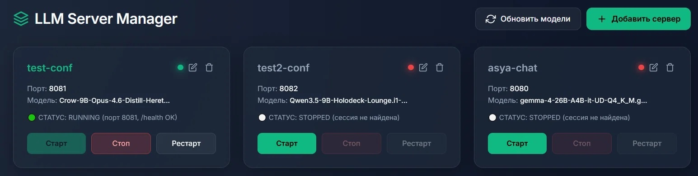

<div align="center">

🇷🇺 **Русский** | [🇬🇧 English](README_EN.md)

</div>

# 🦙 LlamaPanel (LLM Server Manager)

**Автор:** Kayro  
**Репозиторий:** https://github.com/Ivanow/llama_panel

Веб-панель для удобного управления локальными LLM-серверами на базе `llama.cpp`. Позволяет запускать, останавливать и редактировать конфигурации моделей через современный веб-интерфейс, минуя ручное прописывание аргументов в терминале.



## 🚀 Основные возможности

- **Управление жизненным циклом**: Запуск, остановка и перезапуск серверов в один клик (через `tmux`).
- **Умная проверка ресурсов**: Панель автоматически опрашивает `nvidia-smi` и системную память (RAM).
- **Проверка портов**: Защита от запуска двух серверов на одном порту.
- **Визуальный конструктор аргументов**: Удобный выбор параметров (Flash Attention, Draft, Vision и т.д.).
- **Встроенный проводник**: Выбор `.gguf` файлов прямо из веб-интерфейса.

## 📦 Установка (Linux - Ubuntu/Debian)

### Требования
- Linux (Ubuntu 20.04+, Debian 11+)
- Python 3.8+
- Минимум 4 ГБ RAM (для компиляции)
- Опционально: NVIDIA GPU с драйверами CUDA

### Быстрая установка

1. **Клонируйте репозиторий:**
   ```bash
   git clone https://github.com/Ivanow/llama_panel.git
   cd llama_panel
   ```

2. **Запустите скрипт установки:**
   Скрипт автоматически:
   - Установит системные зависимости (git, cmake, tmux, curl, build-essential)
   - Создаст виртуальное окружение Python
   - Скомпилирует llama.cpp под ваше железо
   - Установит все необходимые пакеты
   
   ```bash
   chmod +x install.sh
   ./install.sh
   ```

3. **Запустите панель:**
   ```bash
   source venv/bin/activate
   python3 web_panel/app.py
   ```

4. **Откройте панель:**
   Перейдите по адресу `http://localhost:8090`

## 📖 Использование

### Добавление модели

1. Откройте веб-панель в браузере
2. Нажмите "Создать инстанс"
3. Укажите:
   - **Имя**: уникальное имя для инстанса (например, `llama3-8b`)
   - **Порт**: порт для сервера (например, `8080`)
   - **Модель**: путь к `.gguf` файлу
   - **Аргументы**: дополнительные параметры запуска (опционально)
4. Нажмите "Сохранить"

### Управление сервером

- **Запуск**: нажмите кнопку "Запустить" рядом с нужным инстансом
- **Остановка**: нажмите кнопку "Остановить"
- **Логи**: просмотр логов в реальном времени через кнопку "Логи"

### Просмотр моделей

Панель сканирует папки с моделями на наличие `.gguf`-файлов. По умолчанию это `~/models` и `models/` рядом с репозиторием; любую свою папку или диск задайте переменной окружения `LLAMA_MODELS_DIRS` (список через запятую, например `LLAMA_MODELS_DIRS=/mnt/nas/gguf,/data/models`; значение `/` разрешает навигацию по всей файловой системе). Встроенный проводник умеет ходить по подпапкам выбранной директории. Список можно обновить кнопкой "Обновить" в разделе "Модели".

## 🛠️ Ручная установка (для опытных пользователей)

Если автоматическая установка не подходит:

```bash
# 1. Установите системные зависимости
sudo apt update
sudo apt install -y git cmake tmux curl build-essential

# 2. Клонируйте репозиторий
git clone https://github.com/Ivanow/llama_panel.git
cd llama_panel

# 3. Создайте виртуальное окружение
python3 -m venv venv
source venv/bin/activate

# 4. Установите Python-зависимости
pip install -r requirements.txt

# 5. Скомпилируйте llama.cpp
git clone https://github.com/ggml-org/llama.cpp.git
cd llama.cpp
cmake -B build -DCMAKE_BUILD_TYPE=Release
cmake --build build --config Release -j $(nproc)
cd ..

# 6. Подготовьте файлы
mkdir -p build/bin
cp llama.cpp/build/bin/llama-server build/bin/
chmod +x build/bin/llama-server manager.sh

# 7. Запустите панель
python3 web_panel/app.py
```

## ⚙️ Конфигурация

Конфигурации инстансов хранятся в директории `instances/` в формате `.conf`. Пример:

```bash
MODEL="/path/to/model.gguf"
PORT=8080
ALIAS="my-model"
EXTRA_ARGS="--ctx-size 4096 --threads 4"
```

## 🐛 Устранение неполадок

### Ошибка: "Permission denied" при запуске install.sh
```bash
chmod +x install.sh
```

### Ошибка: "externally managed environment"
Используйте виртуальное окружение:
```bash
python3 -m venv venv
source venv/bin/activate
pip install -r requirements.txt
```

### Компиляция падает с ошибкой "Killed"
Недостаточно оперативной памяти. Ограничьте потоки:
```bash
cd llama.cpp
cmake --build build --config Release -j 2
```

### Порт 8090 уже занят
Измените порт в `web_panel/app.py` или освободите порт:
```bash
sudo lsof -i :8090
sudo kill -9 <PID>
```

## 📄 Лицензия

MIT License

## 🤝 Поддержка

При возникновении проблем создайте Issue в репозитории.
