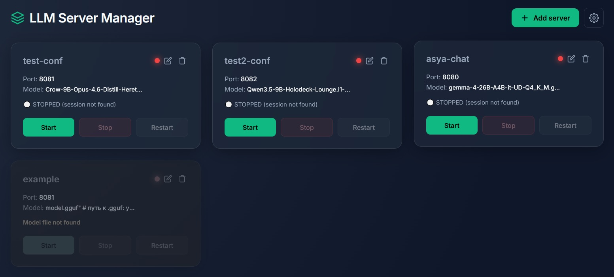

<div align="center">

[🇷🇺 Русский](README_ru.md) | 🇬🇧 **English**

</div>

# 🦙 LlamaPanel (LLM Server Manager)

**Author:** Kayro  
**Repository:** https://github.com/Ivanow/llama_panel

A web panel for easy management of local LLM servers based on `llama.cpp`. It allows you to start, stop, and edit model configurations through a modern web interface, bypassing manual argument typing in the terminal.

- **Localization (i18n)**: The interface and built-in guide are translated into 7 languages (Russian, English, German, Spanish, French, Turkish, Chinese). The language can be switched in the settings menu (⚙️).




## 🎯 Who is this for?

**LlamaPanel** is a lightweight, fast launch manager for your model "junk". 

No matter how many models you have, you can create a dedicated profile for every single one and manage them from any device with a web browser.

*   **Create model profiles (cards) and switch between them in a couple of clicks.** No more racking your brain over which model is running and on what port.
*   **Edit launch arguments in a handy web form.** Tweak GPU layers, context, and special flags, then save and apply them on the fly — right in the same window where you test your prompts.
*   **Spin up local OpenAI-compatible APIs.** Run multiple profiles at once and use them as backends for your apps, IDEs (like Cursor), or AI agents.
*   **Resource shortage protection.** The panel checks if you have enough VRAM and RAM for a new profile. If the model doesn't fit, the Start button locks, and your system won't freeze.

**No more:**
*   Rewriting `systemd` units or typing out long terminal commands just to boot a model.
*   Digging through your brain to remember what you ran, on what port, and where the hell it all is.
*   Bogging down your weak hardware with heavy software just to test a model and see what it can do — with no clunky script "middlemen".

**Who is this NOT for?**
*   **Chat app seekers:** LlamaPanel is a control panel. To actually talk to a model, use a browser or third-party UI.
*   **Windows/macOS users:** Built for Linux. It can theoretically run elsewhere (like WSL on Windows), but requires setting up a Linux environment (uses `tmux` and system calls).
*   **Those without `llama.cpp`:** The panel is useless without `llama-server` installed.


## 🚀 Main Features
- **Initial setup on startup**: Select the AI models directory and automatically check for the llama server. If you don't have the server installed, use our instructions.
- **Changing parameters in the browser**: All panel settings (file paths, ports, launch parameters) are changed through the settings menu in the web interface.
- **Lifecycle management**: Start, stop, and restart servers with one click (via `tmux`).
- **Memory overflow protection**: Before launching a model, the panel checks the amount of free video memory (VRAM) and RAM. If the model does not fit into memory, the "Start" button is blocked, and a message indicating the lack of memory is displayed on the screen.
- **Port conflict protection**: The panel blocks launching a new model if its port is already occupied by another running model.
- **Parameter configuration via interface**: The user can enter arguments manually or through a menu of switches and input fields (number of layers, context size, etc.), with which the panel independently forms the final argument string.
- **Built-in file manager**: A built-in explorer is used to select the model. Navigation through server directories and selection of `.gguf` files are done via mouse clicks in the browser.


## 📦 Installation and Launch (Linux)

**⚠️ Important:** LlamaPanel is a management panel. To run models, the **`llama.cpp`** engine (the `llama-server` file) must be installed and compiled on your system. If you don't have it, follow the [official build instructions](https://github.com/ggerganov/llama.cpp). `python3`, `tmux`, and `curl` are also required.

The `run.sh` script will automatically check for all dependencies on the first run and offer to install them (Ubuntu/Debian, Fedora, Arch, Alpine are supported).

### Option 1. Server Installation
Run in the terminal:
```bash
git clone https://github.com/Ivanow/llama_panel.git
cd llama_panel
chmod +x run.sh
./run.sh
```

### Option 2. Local Computer Installation
**Method A. Via terminal**
Execute the same commands as for the server (see Option 1).

**Method B. Via browser (ZIP download)**
1. Click the green **Code** button on the GitHub page and select **Download ZIP**.
2. Extract the downloaded archive to any folder.
3. Start the panel:
   * **Via terminal:** Open a terminal in the project folder, then run: `chmod +x run.sh && ./run.sh`
   * **Via GUI:** Right-click the `run.sh` file, select **Properties** -> **Permissions** and check **"Allow executing file as program"**. Close properties and double-click `run.sh`.

After launching, the panel will become available in your browser at `http://localhost:8090` (or `http://<SERVER-IP>:8090` if running on a remote machine). On first login, the panel will ask for the path to the `.gguf` models directory and the `llama-server` file if it cannot find it automatically. Or, if you have multiple llama instances, specify the path to the required one.


## 📖 Usage

Using the program starts with running the `run.sh` script.

### Step 1. Startup and dependency check
When activating the script with a mouse click or by pressing the Enter key, a terminal window will appear, or in an already open window, after entering the `./run.sh` command, the script will start working and check if the necessary programs (`python3`, `tmux`, `curl`, `ss`, and the `Flask` web framework) are installed in the system. 

*   **If everything is installed:** the script will immediately proceed to launch the panel.
*   **If something is missing:** the script will display a list of missing components and ask: *"Install them now? (y/n/д/н)"*. 
    *   If you press **`y`** (or **`д`**), the script will automatically install them via your package manager (you will need to enter the administrator password). After installation, the panel will launch.
    *   If you press **`n`** (or **`н`**), the script will close. The program will not work without these components.

When all checks are passed, a launch message will appear in the terminal. **Do not close the terminal window** — while it is open, the panel server is running. (If you press `Ctrl+C`, the panel will stop).

### Step 2. Initial setup in the browser
Open your browser and go to `http://localhost:8090` (or `http://<SERVER-IP>:8090` if running on a remote machine).
On first login, a welcome window will open:
1.  **Models folder.** By default, the panel suggests the `models/` folder inside the project. If this suits you, place your models there. If your `.gguf` files are located elsewhere, click **"Browse"** and select the desired directory.
2.  **Path to `llama-server`.** The panel will try to find the llama executable automatically. If it doesn't find it, click **"Browse"** and specify the file path manually. After clicking the **"Browse"** button, an explorer will open. You need to find the folder containing the `llama-server` file (usually the `build/bin/` folder inside the `llama.cpp` sources) and click once on the `llama-server` file itself (it has no extension, just a name). You cannot select a whole folder — the executable file is required. The selected path will be inserted into the field, and a green message "Llama-server found" will light up below it.
3.  Click **"Save and Start"**.
*(In the future, you can change these paths via the gear icon ⚙️ -> "Server Settings").*

 **Gear icon (⚙️)**
 In the top right corner of the panel, there is a settings menu. Through it, you can at any time:
 *   **Server Settings:** change the models folder and the path to the `llama-server` binary (opens the same window as on the first launch).
 *   **Language:** switch the interface between Russian and English.
 *   **Guide:** open this instruction right in the browser.

### Step 3. Adding a model
1.  Click the **"Add Server"** button.
2.  Enter the **Config Name** (Latin letters, no spaces).
3.  Specify the **Port** (e.g., `8081`). You can use any numbers in the range from 1024 to 65535 (ports below 1024 are reserved by the system and inaccessible without administrator rights). Each new model requires a unique port (e.g., 8080, 8081, 8082). You can do this by entering the number manually or using the counter arrows to the right of the number input field.
4.  Click **"Browse"** and select the `.gguf` model file.
5.  Select the **Work Mode** (Chat, Coder, Vision, etc.). The default settings depend on this.
6.  Click **"Configure"**; in the menu that opens, you can use checkboxes and input fields to specify arguments, for example: the number of model layers for the video card (`--n-gpu-layers`), context size, and other parameters. The panel will assemble them into an argument string itself. (For advanced users: if you know `llama.cpp` flags, you can close this menu and manually edit the "Launch Arguments" string, entering any additional parameters there).
7.  Click **"Create Config"**. After clicking the button, the modal window will close, and a new card with your model's name will appear on the main screen. This means the settings are saved. Now you can click the "Start" button on it.

 ### Step 4. Server Management
 
 Each created model is displayed on the main screen as a card. The card contains:
 *   **Config Name** and **Port**.
 *   **Model file name**.
 *   **Control buttons**: "Start", "Stop", "Restart".
 *   **Status indicator**: Has two states: 🔴 **Red** - server is disconnected. 🟢 **Green** - running.
 *   **Pencil icon (✏️)**: allows you to change the model path, port, and launch arguments (available only for disconnected servers).
 *   **Trash icon (🗑️)**: deletes the config (available only for disconnected servers).
 
 **Server initialization process indicators:**
 *   ⚪ **Gray (Stopped):** The model is not running.
 *   **Yellow "running" (Loading):** When you click the Start button, the model is read from the disk and loaded into memory. At this moment, a **status bar** (loading bar) appears below the buttons. Wait until the gray light turns green (it may take time).
 *   🟢 **Green (Running):** The model is loaded into memory and ready to accept requests.
 *   🔴 **Red (Error):** A failure occurred during startup. Check the logs in the `logs/` folder or click "Restart".
 
 **Gray cards (Error protection):**
 The panel automatically protects you from server crashes. The card will turn gray (and the "Start" button will be blocked) if:
 1.  **Not enough memory:** The model does not fit into free video memory (VRAM) or RAM. The reason will be written directly below the model name (e.g., *"Insufficient VRAM (needs ~5000 MB, 2000 MB free)"*). In this case, you need to stop other running models or reduce the number of layers (`--n-gpu-layers`).
 2.  **Port busy:** You manually specified a port that is already used by another running model. The panel will not allow launching a second model on the same port. Change the port in the settings (pencil).
 3.  **File not found:** The model was deleted or moved from the disk. Check the file path.
 
 **Pop-up messages:**
 If an error occurs when clicking a button (e.g., failed to start the process), the panel will show a pop-up window with the error text. Close it, fix the problem (according to the text), and try again.

**Notes:**
*   **Context size (`--ctx-size`)** can take up additional memory. If the model is small but the card is gray, check the context size. A large context also requires memory. You probably set a huge context (e.g., 1000k), the model may not fit into VRAM even if it is small itself. 
*   **Startup time.** Large models (e.g., 30-40 GB) can take a minute or longer to load from an HDD. Loading large models can take from 10 seconds to several minutes. The loading bar will be displayed until loading finishes.


## ⚙️ Configuration File (server card)

**You don't have to edit this file manually.** All settings are configured through the web interface. However, every time you click "Create Config" or "Save Changes" on the server card, the panel creates or edits a `.conf` file in the `instances/` directory. The file name matches your config name (e.g., `my-model.conf`).

Inside this file, plain text with variables is stored, from which the panel assembles the command to run.

### Basic example
If you configured a simple text model, the file will look like this:

```bash
MODEL="/stor001/models/my_model.gguf"
PORT=8080
ALIAS="my-model"
EXTRA_ARGS="--n-gpu-layers 99 --ctx-size 4096"
```

Breakdown of each line:

*   **`MODEL`**
    *   **What it is:** Full path to the `.gguf` model file.
    *   **How it works:** The panel substitutes this path to the `--model` flag. `llama.cpp` reads this file to load the model weights into memory.
    *   *Note:* If you move the model file to another folder without changing the path, the panel will throw a "Model file not found" error and block the "Start" button.

*   **`PORT`**
    *   **What it is:** The network port on which the server will run.
    *   **How it works:** Passed to the `--port` flag. Your client will send requests to the model at this address (e.g., `http://127.0.0.1:8080/v1`).

*   **`ALIAS`**
    *   **What it is:** Human-readable model name (alias).
    *   **How it works:** Passed to the `--alias` flag. It is used in API responses in the `model` field. Usually matches the config name.

*   **`EXTRA_ARGS`**
    *   **What it is:** A string with additional launch flags.
    *   **How it works:** The panel simply appends everything written here to the end of the launch command. Parameters from the visual builder (the "Configure" button) go here, such as `--n-gpu-layers`, `--ctx-size`, `--threads`, and others.

### Example with a Vision model or Draft
If you use image analysis (Vision) or speculative decoding (Draft), the paths to these auxiliary files **do not create new variables** but are simply appended to the end of `EXTRA_ARGS`. 

The file will look like this:

```bash
MODEL="/stor001/models/vision_model.gguf"
PORT=8080
ALIAS="vision-chat"
EXTRA_ARGS="--n-gpu-layers 99 --ctx-size 8192 --mmproj \"/stor001/models/mmproj.gguf\" -md \"/stor001/models/draft.gguf\" --spec-type draft-simple"
```

In the card on the main screen, only the name of the **main** model is displayed (e.g., `vision_model.gguf`) so as not to clutter the interface. But if you click the pencil (✏️) and open "Configure", the panel will show all specified paths to the projector and draft and will correctly pass them on launch.

### How the panel launches the model (final command)
When you click "Start", the `manager.sh` script puts it all together. Under the hood, approximately the following command is executed:

```bash
llama-server --model "/stor001/models/vision_model.gguf" --port 8080 --host 0.0.0.0 --alias "vision-chat" --n-gpu-layers 99 --ctx-size 8192 --mmproj "/stor001/models/mmproj.gguf" -md "/stor001/models/draft.gguf" --spec-type draft-simple
```

Therefore, if you want to add some exotic flag that is not in the visual builder, you can always open this `.conf` file (or the "Launch Arguments" string in the browser) and add it to `EXTRA_ARGS`.

⚠️ Attention: Be careful when manually editing arguments. The panel checks only the basic syntax, but not the correctness of `llama.cpp` flags. A typo in a parameter name or an incorrect value will cause the model to fail to start (a red error indicator will appear on the card).


## 🛠️ Troubleshooting

### Error "Permission denied" when running run.sh
The file does not have execute permissions. Open a terminal in the project folder and run:
```bash
chmod +x run.sh
```

### Port 8090 is already in use (Panel doesn't open)
Most likely, the panel is already running in another terminal window. If you are sure it is not working, find and terminate the hung process:
```bash
sudo fuser -k 8090/tcp
```
After that, run `./run.sh` again.

### The card turned gray, says "Insufficient VRAM/RAM"
The panel protects your computer from freezing. The model does not fit into memory.
*   **Solution:** Stop other running models (click "Stop" on their cards), or click the pencil (✏️) and reduce the value of `--n-gpu-layers` or `--ctx-size`.

### The card turned gray, says "Port is busy by another server"
You are trying to start a model on a port that is already in use.
*   **Solution:** Click the pencil (✏️) and change the port number to a free one (e.g., 8082).

### I click "Start", but the light turns red (Error)
The model failed to start. To find out the reason:
1. Open the `logs/` folder in the project directory.
2. Find the file with the name of your config (e.g., `my-model.log`).
3. Open it with a text editor. The exact error reason from `llama.cpp` will be written at the end of the file.

### run.sh script cannot install dependencies
If an error occurs during automatic installation:
1. Open a terminal and install the components manually (example for Ubuntu/Debian):
   ```bash
   sudo apt update && sudo apt install -y tmux curl iproute2 python3-flask
   ```
2. After installation, run `./run.sh` again.


## 🗑️ Uninstalling the program

If you want to completely remove LlamaPanel from your server, run the following command in the terminal:

```bash
chmod +x uninstall.sh
./uninstall.sh
```

The script will automatically stop all running models and delete configurations, logs, and system files of the panel. Before deleting heavy folders (`llama.cpp` sources and the `models/` folder with models), the script will request additional confirmation so you don't accidentally lose your files.


## 📄 License

This project is licensed under the MIT License. See the [LICENSE](LICENSE) file for details.

The project uses the [marked](https://github.com/markedjs/marked) library to render Markdown, which is also distributed under the MIT License. The full text of its license can be found in the [LICENSE-marked](LICENSE-marked) file.


## 🤝 Support

If you encounter any problems, please create an Issue in the repository.