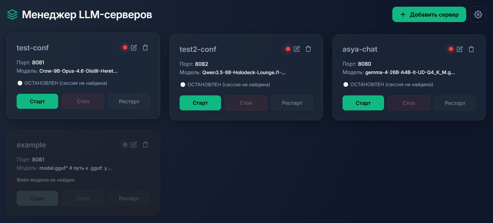

<div align="center">

🇷🇺 **Русский** | [🇬🇧 English](README.md)

</div>

# 🦙 LlamaPanel (LLM Server Manager)

**Автор:** Kayro  
**Репозиторий:** https://github.com/Ivanow/llama_panel

Веб-панель для удобного управления локальными LLM-серверами на базе `llama.cpp`. Позволяет запускать, останавливать и редактировать конфигурации моделей через современный веб-интерфейс, минуя ручное прописывание аргументов в терминале.

- **Мультиязычность (i18n)**: Интерфейс и встроенное руководство переведены на 7 языков (русский, английский, немецкий, испанский, французский, турецкий, китайский). Язык переключается в меню настроек (⚙️).




## 🎯 Для кого это

**LlamaPanel** — это легкий и быстрый старт-менеджер для вашего модельного «хлама». 

Не важно, сколько у вас моделей. Вы можете хоть для каждой из них создать свой профиль и спокойно управлять ими с любого устройства, где работает ваш любимый браузер.

*   **Создавайте профили моделей (карточки) и переключайтесь между ними в пару кликов.** Больше не нужно вспоминать, какая модель сейчас запущена и на каком порту.
*   **Редактируйте аргументы запуска в удобной веб-форме.** Настраивайте слои GPU, контекст и спец. флаги, сохраняйте и применяйте на лету — прямо в том же окне, где вы тестируете свои промпты.
*   **Разворачивайте локальные OpenAI-совместимые API.** Запустите несколько профилей одновременно и используйте их как бэкенды для ваших приложений, IDE (вроде Cursor) или ИИ-агентов.
*   **Защита от нехватки ресурсов.** Панель сама проверит, хватит ли видеопамяти (VRAM) и оперативки (RAM) для нового профиля. Если модель не влезает — кнопка запуска заблокируется, и ваша система не уйдет в зависание.

**Вам больше не нужно:**
*   Каждый раз переписывать `systemd`-юниты или вводить длинные команды в терминале, когда хотите просто запустить модель.
*   Искать и вспоминать, что и на каком порту вы запускали, и где всё это находится.
*   Грузить своё слабое железо тяжелым софтом только ради того, чтобы протестировать модель и понять, на что она способна — без лишних скриптовых «прокладок».

**Кому не подходит:**
*   **Тем, кто ищет готовый чат:** LlamaPanel — это пульт управления. Для общения с моделью используйте браузер или стороннее ПО.
*   **Пользователям Windows/macOS:** Панель разработана под Linux. Потенциально работает в других ОС (например, через WSL на Windows), но требует настройки Linux-окружения (использует `tmux` и системные вызовы).
*   **Если у вас не установлен `llama.cpp`:** Панель будет бесполезна без `llama-server`.


## 🚀 Основные возможности
- **Первичная настройка при запуске**: Выбор каталога ИИ моделей и автоматическая проверка наличия сервера llama. Если сервер у вас не установлен, воспользуйтесь нашей инструкцией.
- **Изменение параметров в браузере**: Все настройки работы панели (пути к файлам, порты, параметры запуска) изменяются через меню настроек в веб-интерфейсе.
- **Управление жизненным циклом**: Запуск, остановка и перезапуск серверов в один клик (через `tmux`).
- **Защита от переполнения памяти**: Перед запуском модели панель проверяет объем свободной видеопамяти (VRAM) и оперативной памяти (RAM). Если модель не помещается в память, кнопка «Старт» блокируется, а на экран выводится сообщение с указанием нехватки памяти.
- **Защита от конфликтов портов**: Панель блокирует запуск новой модели, если её порт уже занят другой работающей моделью.
- **Настройка параметров через интерфейс**: Пользователь может ввести аргументы как в ручную, так и через меню переключателей и полей ввода (количество слоев, размер контекста и т.д.), с помощью которого панель самостоятельно формирует итоговую строку аргументов.
- **Встроенный файловый менеджер**: Для выбора модели используется встроенный проводник. Перемещение по директориям сервера и выбор файлов `.gguf` осуществляются кликами мыши в браузере.


## 📦 Установка и запуск (Linux)

**⚠️ Важно:** LlamaPanel — это панель управления. Для запуска моделей в системе должен быть установлен и собран движок **`llama.cpp`** (файл `llama-server`). Если у вас его нет, воспользуйтесь [официальной инструкцией по сборке](https://github.com/ggerganov/llama.cpp). Также требуются `python3`, `tmux` и `curl`.

Скрипт `run.sh` при первом запуске автоматически проверит наличие всех зависимостей и предложит их установить (поддерживаются Ubuntu/Debian, Fedora, Arch, Alpine).

### Вариант 1. Установка на сервер
Выполните в терминале:
```bash
git clone https://github.com/Ivanow/llama_panel.git
cd llama_panel
chmod +x run.sh
./run.sh
```

### Вариант 2. Установка на локальный компьютер
**Способ А. Через терминал**
Выполните те же команды, что и для сервера (см. Вариант 1).

**Способ Б. Через браузер (скачивание ZIP)**
1. Нажмите зеленую кнопку **Code** на странице GitHub и выберите **Download ZIP**.
2. Распакуйте скачанный архив в любую папку.
3. Запуск панели:
   * **Через терминал:** Откройте терминал в папке с проектом, затем выполните: `chmod +x run.sh && ./run.sh`
   * **Через графический интерфейс:** Щелкните правой кнопкой мыши по файлу `run.sh`, выберите **Свойства** -> **Права** и поставьте галочку **«Разрешить выполнение файла как программы»**. Закройте свойства и дважды кликните по `run.sh`.

После запуска панель станет доступна в браузере по адресу `http://localhost:8090` (или `http://<IP-сервера>:8090`, если запускаете на удаленной машине). При первом входе панель попросит указать путь к каталогу с моделями `.gguf` и файлу `llama-server`, если не найдет его автоматически. Или, если у вас несколько llama, укажите путь к нужному.


## 📖 Использование

Использование программы начинается с запуска скрипта `run.sh`.

### Шаг 1. Запуск и проверка зависимостей
При ативации скрипта мышкой или по нажатию клавиши Enter, появится окно терминала, либо в уже открытом окне, после ввода команды `./run.sh` скрипт начнет работу и проверит, установлены ли в системе необходимые программы (`python3`, `tmux`, `curl`, `ss` и веб-фреймворк `Flask`). 

*   **Если всё установлено:** скрипт сразу перейдет к запуску панели.
*   **Если чего-то не хватает:** скрипт выведет список отсутствующих компонентов и спросит: *"Установить их сейчас? (y/n/д/н)"*. 
    *   Если нажать **`y`** (или **`д`**), скрипт автоматически установит их через ваш пакетный менеджер (потребуется ввести пароль администратора). После установки панель запустится.
    *   Если нажать **`n`** (или **`н`**), скрипт закроется. Без этих компонентов программа не сможет работать.

Когда все проверки пройдены, в терминале появится сообщение о запуске. **Окно терминала закрывать нельзя** — пока оно открыто, работает сервер панели. (Если вы нажмете `Ctrl+C`, панель остановится).

### Шаг 2. Первичная настройка в браузере
Откройте браузер и перейдите по адресу `http://localhost:8090` (или `http://<IP-сервера>:8090`, если запускаете на удаленной машине).
При первом входе откроется приветственное окно:
1.  **Папка с моделями.** По умолчанию панель предлагает папку `models/` внутри проекта. Если вас это устраивает, размещайте модели там. Если же ваши `.gguf` файлы лежат в другом месте, нажмите **«Обзор»** и выберите нужную директорию.
2.  **Путь к `llama-server`.** Панель попытается найти исполняемый файл llama автоматически. Если она его не нашла, нажмите **«Обзор»** и укажите путь к файлу вручную. После нажатия на кнопку **«Обзор»** откроется проводник. Вам нужно найти папку, в которой лежит файл llama-server (обычно это папка build/bin/ внутри исходников llama.cpp), и кликнуть один раз именно на сам файл llama-server (он не имеет расширения, просто имя). Выбрать папку целиком нельзя — нужен именно исполняемый файл. Выбранный путь подставится в поле, а под ним загорится зеленая надпись «Llama-server найден».
3.  Нажмите **«Сохранить и начать»**.
*(В дальнейшем изменить эти пути можно через иконку шестеренки ⚙️ -> «Настройки сервера»).*

 **Иконка шестеренки (⚙️)**
 В правом верхнем углу панели находится меню настроек. Через него можно в любой момент:
 *   **Настройки сервера:** изменить папку с моделями и путь к бинарнику `llama-server` (вызывается то же окно, что и при первом запуске).
 *   **Язык:** переключить интерфейс между русским и английским.
 *   **Руководство:** открыть эту инструкцию прямо в браузере.


### Шаг 3. Добавление модели
1.  Нажмите кнопку **«Добавить сервер»**.
2.  Введите **Имя конфига** (латиницей, без пробелов).
3.  Укажите **Порт** (например, `8081`). Для номера порта вы можете использовать любые числа в диапазоне от 1024 до 65535 (порты ниже 1024 зарезервированы системой и недоступны без прав администратора). Для каждой новой модели нужно указывать уникальный порт (например, 8080, 8081, 8082). Это можно сделать внеся номер в ручную или с помощью стрелок счетчика, по правую сторону от поля ввода номера.
4.  Нажмите **«Обзор»** и выберите `.gguf` файл модели.
5.  Выберите **Режим работы** (Чат, Кодер, Vision и т.д.). От этого зависят настройки по умолчанию.
6.  Нажмите **«Настроить»**, в открывшемся меню вы можете с помощью галочек и полей ввода указать аргументы, например: количество слоев модели для видеокарты (--n-gpu-layers), размер контекста и другие параметры. Панель сама соберет из них строку аргументов. (Для продвинутых пользователей: если вы знаете флаги llama.cpp, вы можете закрыть это меню и вручную отредактировать строку «Аргументы запуска», вписав туда любые дополнительные параметры).
7.  Нажмите **«Создать конфиг»**. После нажатия кнопки модальное окно закроется, а на главном экране появится новая карточка с именем вашей модели. Это означает, что настройки сохранены. Теперь вы можете нажать на ней кнопку «Старт».

 ### Шаг 4. Управление сервером
 
 Каждая созданная модель отображается на главном экране в виде карточки. На карточке расположены:
 *   **Название конфига** и **Порт**.
 *   **Имя файла модели**.
 *   **Кнопки управления**: «Старт», «Стоп», «Рестарт».
 *   **Индикатор состояния**: Имеет два вида: 🔴 **Красный** - сервер отключен. 🟢 **Зеленый** - работает.
 *   **Иконка карандаша (✏️)**: позволяет изменить путь к модели, порт и аргументы запуска (доступна только для выключенных серверов).
 *   **Иконка корзины (🗑️)**: удаляет конфиг (доступна только для выключенных серверов).
 
 **Индикаторы процесса инициализации сервера:**
 *   ⚪ **Серый (Остановлен):** Модель не запущена.
 *   **Желтый "бегущий" (Загрузка):** При нажатии на кнопку `Старт` модель читается с диска и загружается в память. В этот момент под кнопками появляется **статус-бар** (полоска загрузки). Дождитесь, пока серый огонек станет зеленым (может потребоваться время).
 *   🟢 **Зеленый (Работает):** Модель загружена в память и готова принимать запросы.
 *   🔴 **Красный (Ошибка):** Произошел сбой при запуске. Проверьте логи в папке `logs/` или нажмите «Рестарт».
 
 **Серые карточки (Защита от ошибок):**
 Панель автоматически защищает вас от падения сервера. Карточка станет серой (а кнопка «Старт» заблокируется), если:
 1.  **Не хватает памяти:** Модель не помещается в свободную видеопамять (VRAM) или оперативную память (RAM). Причина будет написана прямо под названием модели (например, *«Недостаточно VRAM (нужно ~5000 МБ, свободно 2000 МБ)»*). В этом случае вам нужно остановить другие запущенные модели или уменьшить количество слоев (`--n-gpu-layers`).
 2.  **Порт занят:** Вы вручную указали порт, который уже используется другой работающей моделью. Панель не даст запустить вторую модель на том же порту. Измените порт в настройках (карандаш).
 3.  **Файл не найден:** Модель была удалена или перемещена с диска. Проверьте путь к файлу.
 
 **Всплывающие сообщения:**
 Если при нажатии на кнопку произошла ошибка (например, не удалось запустить процесс), панель покажет всплывающее окно с текстом ошибки. Закройте его, исправьте проблему (согласно тексту) и попробуйте снова.

**Примечания:**
*   **Размер контекста (`--ctx-size`)** может занимать дополнительную память. Если модель маленькая, но карточка серая, проверьте размер контекста. Большой контекст тоже требует памяти. Вероятно вы поставили огромный контекст (например, 1000к), модель может не влезть в VRAM, даже если сама она маленькая. 
*   **Время запуска.** Большие модели (например, на 30-40 ГБ) могут грузиться с HDD минуту или дольше. Загрузка больших моделей может занимать от 10 секунд до нескольких минут. Полоска загрузки будет отображаться до окончания загрузки"*.


## ⚙️ Конфигурационный файл (карточка сервера)

**Вам не обязательно редактировать этот файл вручную.** Все настройки выполняются через веб-интерфейс. Однако каждый раз, когда вы нажимаете «Создать конфиг» или «Сохранить изменения» на карточке сервера, панель создает или редактирует файл формата `.conf` в директории `instances/`. Имя файла совпадает с именем вашего конфига (например, `my-model.conf`).

Внутри этого файла хранится обычный текст с переменными, из которых панель собирает команду для запуска.

### Базовый пример
Если вы настроили простую текстовую модель, файл будет выглядеть так:

```bash
MODEL="/stor001/models/my_model.gguf"
PORT=8080
ALIAS="my-model"
EXTRA_ARGS="--n-gpu-layers 99 --ctx-size 4096"
```

Разбор каждой строки:

*   **`MODEL`**
    *   **Что это:** Полный путь к файлу модели `.gguf`.
    *   **Как работает:** Панель подставляет этот путь к флагу `--model`. `llama.cpp` читает этот файл, чтобы загрузить веса модели в память.
    *   *Примечание:* Если вы переместите файл модели в другую папку, не изменив путь, панель выдаст ошибку «Файл модели не найден» и заблокирует кнопку «Старт».

*   **`PORT`**
    *   **Что это:** Сетевой порт, на котором будет работать сервер.
    *   **Как работает:** Передается флагу `--port`. По этому адресу (например, `http://127.0.0.1:8080/v1`) ваш клиент будет отправлять запросы к модели.

*   **`ALIAS`**
    *   **Что это:** Человекочитаемое имя модели (псевдоним).
    *   **Как работает:** Передается флагу `--alias`. Оно используется в ответах API в поле `model`. Обычно совпадает с именем конфига.

*   **`EXTRA_ARGS`**
    *   **Что это:** Строка с дополнительными флагами запуска.
    *   **Как работает:** Панель просто добавляет всё, что здесь написано, в конец команды запуска. Сюда попадают параметры из визуального конструктора (кнопка «Настроить»), такие как `--n-gpu-layers`, `--ctx-size`, `--threads` и другие.

### Пример с Vision-моделью или Draft
Если вы используете анализ картинок (Vision) или спекулятивное декодирование (Draft), пути к этим вспомогательным файлам **не создают новых переменных**, а просто дописываются в конец `EXTRA_ARGS`. 

Файл будет выглядеть так:

```bash
MODEL="/stor001/models/vision_model.gguf"
PORT=8080
ALIAS="vision-chat"
EXTRA_ARGS="--n-gpu-layers 99 --ctx-size 8192 --mmproj \"/stor001/models/mmproj.gguf\" -md \"/stor001/models/draft.gguf\" --spec-type draft-simple"
```

В карточке на главном экране при этом отображается только имя **основной** модели (например, `vision_model.gguf`), чтобы не загромождать интерфейс. Но если нажать на карандаш (✏️) и открыть «Настроить», панель покажет все прописанные пути к проектору и драфту, и корректно передаст их при запуске.

### Как панель запускает модель (итоговая команда)
Когда вы нажимаете «Старт», скрипт `manager.sh` собирает всё воедино. Под капотом выполняется примерно следующая команда:

```bash
llama-server --model "/stor001/models/vision_model.gguf" --port 8080 --host 0.0.0.0 --alias "vision-chat" --n-gpu-layers 99 --ctx-size 8192 --mmproj "/stor001/models/mmproj.gguf" -md "/stor001/models/draft.gguf" --spec-type draft-simple
```

Поэтому, если вы хотите добавить какой-то экзотический флаг, которого нет в визуальном конструкторе, вы всегда можете открыть этот `.conf` файл (или строку «Аргументы запуска» в браузере) и дописать его в `EXTRA_ARGS`.

⚠️ Внимание: Будьте внимательны при ручном редактировании аргументов. Панель проверяет только базовый синтаксис, но не правильность флагов llama.cpp. Опечатка в названии параметра или неверное значение приведет к тому, что модель не запустится (на карточке появится красный индикатор ошибки).


## 🛠️ Устранение неполадок

### Ошибка «Permission denied» при запуске run.sh
У файла нет прав на выполнение. Откройте терминал в папке с проектом и выполните:
```bash
chmod +x run.sh
```

### Порт 8090 уже занят (Панель не открывается)
Скорее всего, панель уже запущена в другом окне терминала. Если вы уверены, что она не работает, найдите и завершите зависший процесс:
```bash
sudo fuser -k 8090/tcp
```
После этого запустите `./run.sh` заново.

### Карточка стала серой, пишет «Недостаточно VRAM/RAM»
Панель защищает ваш компьютер от зависания. Модель не помещается в память.
*   **Решение:** Остановите другие запущенные модели (нажмите «Стоп» на их карточках), либо нажмите на карандаш (✏️) и уменьшите значение `--n-gpu-layers` или `--ctx-size`.

### Карточка стала серой, пишет «Порт занят другим сервером»
Вы пытаетесь запустить модель на порту, который уже используется.
*   **Решение:** Нажмите на карандаш (✏️) и измените номер порта на свободный (например, на 8082).

### Нажимаю «Старт», но огонек становится красным (Ошибка)
Модель не смогла запуститься. Чтобы узнать причину:
1. Откройте папку `logs/` в директории проекта.
2. Найдите файл с названием вашего конфига (например, `my-model.log`).
3. Откройте его текстовым редактором. В конце файла будет написана точная причина ошибки от `llama.cpp`.

### Скрипт run.sh не может установить зависимости
Если при автоматической установке возникает ошибка:
1. Откройте терминал и установите компоненты вручную (пример для Ubuntu/Debian):
   ```bash
   sudo apt update && sudo apt install -y tmux curl iproute2 python3-flask
   ```
2. После установки запустите `./run.sh` снова.


## 🗑️ Удаление программы

Если вы хотите полностью удалить LlamaPanel с сервера, выполните в терминале команду:

```bash
chmod +x uninstall.sh
./uninstall.sh
```

Скрипт автоматически остановит все запущенные модели и удалит конфигурации, логи и служебные файлы панели. Перед удалением тяжелых папок (исходников `llama.cpp` и папки с моделями `models/`) скрипт запросит дополнительное подтверждение, чтобы вы случайно не потеряли свои файлы.


## 📄 Лицензия

Проект распространяется под лицензией MIT. Подробности в файле [LICENSE](LICENSE).

В проекте используется библиотека [marked](https://github.com/markedjs/marked) для отображения Markdown. Она также распространяется под лицензией MIT. Полный текст лицензии находится в файле [LICENSE-marked](LICENSE-marked).

## 🤝 Поддержка

При возникновении проблем создайте Issue в репозитории.
